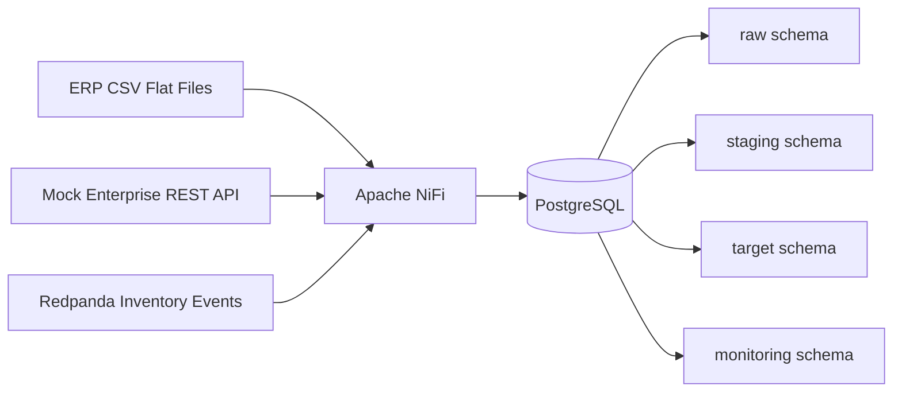

# Retail Supply Chain Integration Platform

Production-style data integration project simulating enterprise retail supply chain integrations across flat files, REST APIs, and Kafka-compatible event streams.

The project demonstrates practical Data Integration Engineering skills using Apache NiFi, PostgreSQL, FastAPI, Redpanda, Python, SQL-based validation, rejected record handling, audit logging, and source-to-target reconciliation.

## Business Scenario

A retail organization needs to integrate supply chain data from multiple enterprise systems into a centralized PostgreSQL platform used for supply chain planning, reporting, and operational monitoring.

The simulated sources include:

- ERP flat files for product, supplier, and location master data
- REST APIs for sales orders, purchase orders, and shipments
- Kafka-compatible inventory event streams
- Intentional bad records to demonstrate validation, rejection, troubleshooting, and reconciliation

## Architecture



## Core Capabilities

- Flat-file batch ingestion
- REST API ingestion
- Event-based integration
- Raw, staging, target, and monitoring schemas
- Data quality validation
- Rejected record handling
- Batch audit logs
- Source-to-target reconciliation
- Troubleshooting guide and operational runbook

## Local Stack

| Component | Purpose |
|---|---|
| PostgreSQL 16 | Integration database |
| Apache NiFi | Middleware and flow orchestration |
| FastAPI | Mock enterprise API |
| Redpanda | Kafka-compatible event streaming |
| Adminer | PostgreSQL web UI |
| Python 3.12 | Data generation and event producers |

## Start Core Services

```powershell
docker compose up -d postgres adminer mock-api
```

## Start Middleware

```powershell
docker compose --profile middleware up -d nifi
```

NiFi UI:

```text
https://localhost:8443/nifi
```

## Start Eventing Services

```powershell
docker compose --profile eventing up -d redpanda redpanda-console
```

Redpanda Console:

```text
http://localhost:8081
```

## PostgreSQL Access

Adminer:

```text
http://localhost:8082
```

Connection:

```text
System: PostgreSQL
Server: postgres
Username: integration_user
Password: integration_password
Database: integration_platform
```

## Current Status

Phase 1: environment foundation.