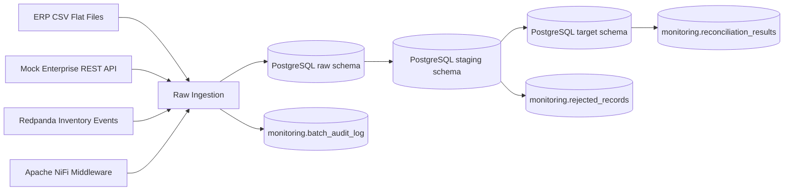
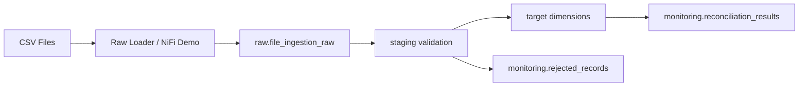
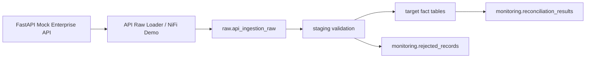
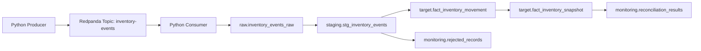
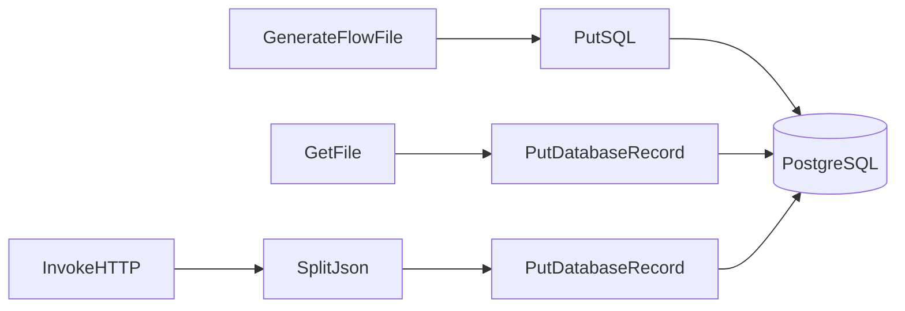

# Retail Supply Chain Integration Platform

Production-style Data Integration Engineering project simulating enterprise retail supply chain integrations across flat files, REST APIs, event streams, middleware orchestration, SQL validation, rejected record handling, audit logging, and source-to-target reconciliation.

This project is designed to demonstrate practical integration engineering patterns for roles such as:

- Data Integration Engineer
- Integration Engineer
- Data Engineer
- Analytics/Data Platform Engineer
- Supply Chain Data Engineer

## Business Scenario

A retail company needs to integrate supply chain data from multiple enterprise systems into a centralized PostgreSQL platform used for supply chain planning, operational monitoring, and downstream analytics.

The simulated source systems include:

| Source | Integration Type | Data |
|---|---|---|
| ERP flat files | Batch CSV | Products, suppliers, locations |
| Enterprise REST API | API-based integration | Sales orders, purchase orders, shipments |
| Warehouse event stream | Kafka-compatible events | Inventory movements |
| Apache NiFi middleware | Visual orchestration | JDBC, flat-file ingestion, API ingestion |

The platform demonstrates how integration pipelines can handle good records, bad records, duplicates, referential integrity failures, business rule violations, and source-to-target reconciliation.

## Architecture



## Core Capabilities

- Flat-file batch ingestion
- REST API ingestion with pagination
- Event-based inventory integration using Redpanda
- Apache NiFi visual middleware demos
- PostgreSQL raw, staging, target, and monitoring schemas
- Data quality validation
- Rejected record handling
- Duplicate event handling / idempotency
- SQL upserts / merges
- Source-to-target reconciliation
- Batch audit logs
- Operational documentation and troubleshooting guides

## Tech Stack

| Component | Purpose |
|---|---|
| PostgreSQL 16 | Integration database |
| Apache NiFi | Middleware and visual flow orchestration |
| FastAPI | Mock enterprise REST API |
| Redpanda | Kafka-compatible event streaming |
| Python 3.12 | Data generation, API loaders, event producer/consumer |
| SQL / PLpgSQL | Validation, upserts, reconciliation |
| Docker Compose | Local reproducible environment |
| Adminer | PostgreSQL UI |
| Redpanda Console | Event topic inspection |

## Data Model Layers

| Schema | Purpose |
|---|---|
| `raw` | Landing zone for flat files, API responses, and event messages |
| `staging` | Parsed and validated records with accepted/rejected status |
| `target` | Integrated supplier, product, location, order, shipment, and inventory tables |
| `monitoring` | Audit logs, rejected records, validation results, and reconciliation results |

## Integration Flows

### 1. Flat-File Integration



Entities:

- Suppliers
- Products / SKUs
- Locations / Stores / DCs / Warehouses

Demonstrated patterns:

- CSV ingestion
- Schema and business validation
- Duplicate detection
- Referential integrity validation
- Rejected record capture
- Target upserts
- Batch audit logs
- Source-to-target reconciliation

### 2. API-Based Integration



Endpoints:

- `/api/v1/sales-orders`
- `/api/v1/purchase-orders`
- `/api/v1/shipments`

Demonstrated patterns:

- REST API ingestion
- Pagination
- Incremental filter support through `updated_since`
- API bad-record simulation
- Source-to-target reconciliation
- Operational audit logging

### 3. Event-Based Inventory Integration



Demonstrated patterns:

- Kafka-compatible event streaming
- Event producer
- Event consumer
- Duplicate `event_id` handling
- Idempotent raw ingestion
- Inventory movement processing
- Inventory snapshot updates
- Event stream reconciliation

### 4. Apache NiFi Middleware Demos



NiFi demonstrates:

- PostgreSQL JDBC connectivity through `DBCPConnectionPool`
- Flat-file ingestion using `GetFile` and `PutDatabaseRecord`
- API ingestion using `InvokeHTTP`, `SplitJson`, and `PutDatabaseRecord`

## Data Quality Rules

Examples of validation rules implemented in SQL:

| Area | Example Rules |
|---|---|
| Schema/type validation | Required fields, numeric casts, timestamp casts |
| Duplicate detection | Duplicate supplier IDs, product IDs, location IDs, event IDs |
| Referential integrity | Product must exist, supplier must exist, location must exist |
| Business rules | Quantity must be greater than zero, delivery date cannot precede order date |
| Event rules | Valid event type, valid reason code, non-zero quantity change |
| Operational rules | Accepted count must match loaded count |

## Monitoring Tables

| Table | Purpose |
|---|---|
| `monitoring.batch_audit_log` | Tracks each batch/source load |
| `monitoring.rejected_records` | Stores invalid records and rejection reasons |
| `monitoring.validation_results` | Stores validation outcomes |
| `monitoring.reconciliation_results` | Stores source-to-target reconciliation outcomes |
| `monitoring.nifi_connectivity_test` | Proves NiFi JDBC connectivity |

## Example Reconciliation Result

The platform reconciles every integration batch using this rule:

```text
accepted_count must equal loaded_count
source_count must equal accepted_count + rejected_count
```

Example status:

```text
MATCHED_WITH_REJECTIONS
```

This means the batch completed successfully, valid records were loaded, invalid records were rejected, and source-to-target counts reconciled.

## Quick Reviewer Path

For a fast review, start with:

| File | Purpose |
|---|---|
| `docs/reviewer_guide.md` | Fast evaluation path and key project highlights |
| `docs/architecture.md` | System architecture and schema responsibilities |
| `docs/source_to_target_mapping.md` | Source-to-target mapping discipline |
| `docs/data_quality_rules.md` | Validation, rejected records, and reconciliation rules |
| `sql/17_final_validation_checks.sql` | Final validation checks for expected outputs |

## Local Setup

### 1. Clone and enter the project

```powershell
git clone https://github.com/rirts/retail-supply-chain-integration-platform.git
cd retail-supply-chain-integration-platform
```

### 2. Create Python virtual environment

```powershell
python -m venv .venv
.\.venv\Scripts\Activate.ps1
python -m pip install --upgrade pip
python -m pip install -r requirements.txt
```

### 3. Create `.env`

```powershell
Copy-Item .env.example .env
```

### 4. Download NiFi PostgreSQL JDBC Driver

```powershell
Invoke-WebRequest `
  -Uri "https://repo1.maven.org/maven2/org/postgresql/postgresql/42.7.12/postgresql-42.7.12.jar" `
  -OutFile "nifi/drivers/postgresql-42.7.12.jar"
```

### 5. Start services

```powershell
docker compose --profile middleware --profile eventing up -d --build
```

### 6. Validate services

```powershell
docker compose ps
```

Useful URLs:

| Service | URL |
|---|---|
| FastAPI docs | `http://localhost:8000/docs` |
| Adminer | `http://localhost:8082` |
| NiFi | `https://localhost:8443/nifi` |
| Redpanda Console | `http://localhost:8081` |

## Run the Full Demo

### 1. Generate flat-file data

```powershell
python scripts/generate_master_data_files.py --seed 42
```

### 2. Run flat-file integration

```powershell
python scripts/load_master_data_to_raw.py
python scripts/validate_master_data_batches.py
python scripts/load_master_data_targets.py
```

### 3. Run API integration

```powershell
python scripts/load_api_data_to_raw.py
python scripts/validate_api_batches.py
python scripts/load_api_targets.py
```

### 4. Run event stream integration

Create topic if needed:

```powershell
docker exec -it rscp_redpanda rpk topic create inventory-events --brokers localhost:9092
```

Produce and consume events:

```powershell
python scripts/produce_inventory_events.py --count 200 --seed 42
python scripts/consume_inventory_events_to_raw.py --max-messages 206
python scripts/validate_inventory_event_batch.py
python scripts/load_inventory_targets.py
```

### 5. Run demo queries

```powershell
docker exec -it rscp_postgres psql -U integration_user -d integration_platform -f /docker-entrypoint-initdb.d/07_demo_queries.sql
```

## Key Demo Queries

### Batch audit summary

```sql
select
    entity_name,
    batch_type,
    source_count,
    accepted_count,
    rejected_count,
    loaded_count,
    status
from monitoring.batch_audit_log
order by created_at;
```

### Rejected records by reason

```sql
select
    entity_name,
    rejection_stage,
    rejection_reason,
    count(*) as rejected_count
from monitoring.rejected_records
group by 1, 2, 3
order by entity_name, rejected_count desc;
```

### Source-to-target reconciliation

```sql
select
    entity_name,
    source_count,
    accepted_count,
    rejected_count,
    loaded_count,
    count_difference,
    status
from monitoring.reconciliation_results
order by reconciled_at;
```

## Documentation

| Document | Purpose |
|---|---|
| `docs/data_generation.md` | Synthetic data generation |
| `docs/flat_file_integration.md` | Flat-file integration flow |
| `docs/api_integration.md` | API integration flow |
| `docs/event_stream_integration.md` | Event stream integration flow |
| `docs/nifi_integration.md` | Apache NiFi setup and demos |
| `docs/source_to_target_mapping.md` | Source-to-target mappings for flat files, APIs, events, and NiFi demos |
| `docs/data_quality_rules.md` | Data quality, rejected record, and reconciliation rules |
| `docs/operational_runbook.md` | Operational instructions for running and validating the platform |
| `docs/troubleshooting_guide.md` | Common issues, fixes, and debugging checklist |
| `docs/technical_decisions.md` | Explanation of major architecture and implementation decisions |
| `docs/demo_walkthrough.md` | Step-by-step demo execution guide |
| `docs/reviewer_guide.md` | Fast review path and project evaluation guide |

## Project Status

Completed:

- Flat-file integration
- API integration
- Event stream integration
- Rejected records
- Batch audit logs
- Source-to-target reconciliation
- Duplicate event handling / idempotency
- NiFi PostgreSQL connectivity
- NiFi flat-file ingestion demo
- NiFi API ingestion demo
- Operational runbook
- Troubleshooting guide
- Source-to-target mapping
- Data quality documentation
- Technical decisions documentation
- Reviewer guide
- Final validation checks

Final validation:

```powershell
docker exec -it rscp_postgres psql -U integration_user -d integration_platform -f /docker-entrypoint-initdb.d/17_final_validation_checks.sql
```

Expected result:

```text
All validation checks return PASS.
```