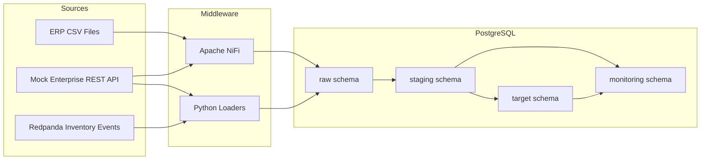
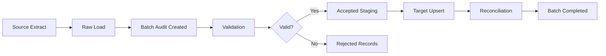

# Architecture

## Overview

The Retail Supply Chain Integration Platform simulates enterprise data integration for a retail supply chain planning environment.

The architecture is designed around four core principles:

1. Separate source ingestion from validation and target loading.
2. Preserve raw source payloads for traceability.
3. Store rejected records with explicit rejection reasons.
4. Reconcile every batch from source to target.

## High-Level Architecture



## Component Responsibilities

| Component | Responsibility |
|---|---|
| PostgreSQL | Raw storage, validation, staging, target tables, audit, reconciliation |
| Apache NiFi | Visual middleware orchestration demos |
| FastAPI | Mock enterprise API for operational supply chain data |
| Redpanda | Kafka-compatible event streaming |
| Python | Data generation, API loading, event producer/consumer |
| SQL / PLpgSQL | Validation, rejected records, upserts, reconciliation |

## PostgreSQL Schemas

### `raw`

The `raw` schema stores source records close to their original form.

Examples:

| Table | Purpose |
|---|---|
| `raw.file_ingestion_raw` | Raw CSV records as JSON payloads |
| `raw.api_ingestion_raw` | Raw API response records |
| `raw.inventory_events_raw` | Raw inventory event payloads |
| `raw.nifi_products_file_raw` | NiFi flat-file ingestion demo |
| `raw.nifi_sales_orders_api_raw` | NiFi API ingestion demo |

### `staging`

The `staging` schema stores parsed and validated records.

Examples:

| Table | Purpose |
|---|---|
| `staging.stg_suppliers` | Validated supplier records |
| `staging.stg_products` | Validated product records |
| `staging.stg_locations` | Validated location records |
| `staging.stg_sales_orders` | Validated sales orders |
| `staging.stg_purchase_orders` | Validated purchase orders |
| `staging.stg_shipments` | Validated shipments |
| `staging.stg_inventory_events` | Validated inventory events |

### `target`

The `target` schema stores integrated business-ready records.

Examples:

| Table | Purpose |
|---|---|
| `target.dim_supplier` | Supplier dimension |
| `target.dim_product` | Product dimension |
| `target.dim_location` | Location dimension |
| `target.fact_sales_order` | Sales order facts |
| `target.fact_purchase_order` | Purchase order facts |
| `target.fact_shipment` | Shipment facts |
| `target.fact_inventory_movement` | Inventory event movements |
| `target.fact_inventory_snapshot` | Current inventory by product/location |

### `monitoring`

The `monitoring` schema supports operational observability.

| Table | Purpose |
|---|---|
| `monitoring.batch_audit_log` | One row per integration batch |
| `monitoring.rejected_records` | Invalid records with rejection reason |
| `monitoring.validation_results` | Validation summaries |
| `monitoring.reconciliation_results` | Source-to-target reconciliation results |
| `monitoring.nifi_connectivity_test` | NiFi JDBC connectivity test |

## Batch Lifecycle

Every integration batch follows the same lifecycle:



## Status Values

| Status | Meaning |
|---|---|
| `RAW_LOADED` | Source data landed in raw tables |
| `VALIDATED` | Records validated and separated into accepted/rejected |
| `COMPLETED` | Batch loaded with no rejected records |
| `COMPLETED_WITH_REJECTIONS` | Valid records loaded and invalid records rejected |
| `RECONCILIATION_FAILED` | Loaded count did not match accepted count |
| `FAILED` | Batch failed during processing |

## Reconciliation Logic

The core reconciliation logic is:

```text
source_count = accepted_count + rejected_count
accepted_count = loaded_count
```

If both rules pass and rejected records exist, the batch status becomes:

```text
COMPLETED_WITH_REJECTIONS
```

This is considered a successful controlled load.

## Design Decision: SQL-Centered Validation

The project uses SQL/PLpgSQL for deterministic validation, upserts, and reconciliation.

NiFi is used for visual middleware ingestion demos, while PostgreSQL handles:

- record-level validation
- referential integrity checks
- rejected record insertion
- target table upserts
- reconciliation calculations

This mirrors common enterprise patterns where middleware orchestrates movement and routing, while database procedures enforce deterministic business rules.