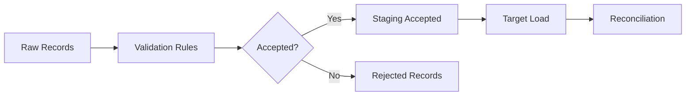

# Data Quality Rules

## Overview

This project implements deterministic data quality validation for flat-file, API, and event-stream integrations.

The goal is not to silently clean bad data. The goal is to:

1. Preserve raw source records.
2. Validate records using explicit business and technical rules.
3. Load valid records into target tables.
4. Store invalid records with clear rejection reasons.
5. Reconcile every batch from source to target.

## Data Quality Strategy



## Validation Outcomes

Each record is classified as:

| Status | Meaning |
|---|---|
| `ACCEPTED` | Record passed validation and can be loaded |
| `REJECTED` | Record failed one or more validation rules |

Rejected records are written to:

```text
monitoring.rejected_records
```

Each rejected record includes:

| Field | Purpose |
|---|---|
| `batch_id` | Links the rejection to the source batch |
| `entity_name` | Identifies the entity being processed |
| `source_record_id` | Identifies the failed source record when available |
| `rejection_stage` | Shows where the rejection happened |
| `rejection_reason` | Explains why the record failed |
| `raw_payload` | Preserves the original source record |

---

# Flat-File Data Quality Rules

Flat-file validation applies to supplier, product, and location master data.

## Supplier Rules

| Rule | Rejection Reason |
|---|---|
| `supplier_id` is required | Missing supplier ID |
| `supplier_id` must be unique within batch | Duplicate supplier ID |
| `supplier_name` is required | Missing supplier name |
| `supplier_type` must be valid | Invalid supplier type |
| `country` is required | Missing country |
| `supplier_status` must be valid | Invalid supplier status |

## Product Rules

| Rule | Rejection Reason |
|---|---|
| `product_id` is required | Missing product ID |
| `product_id` must be unique within batch | Duplicate product ID |
| `sku` is required | Missing SKU |
| `product_name` is required | Missing product name |
| `category` is required | Missing category |
| `supplier_id` is required | Missing supplier ID |
| `supplier_id` must reference accepted supplier | Supplier does not exist |
| `unit_cost` must be numeric | Invalid unit cost |
| `unit_cost` must be non-negative | Negative unit cost |
| `product_status` must be valid | Invalid product status |

## Location Rules

| Rule | Rejection Reason |
|---|---|
| `location_id` is required | Missing location ID |
| `location_id` must be unique within batch | Duplicate location ID |
| `location_name` is required | Missing location name |
| `location_type` must be valid | Invalid location type |
| `region` is required | Missing region |
| `country` is required | Missing country |
| `location_status` must be valid | Invalid location status |

---

# API Data Quality Rules

API validation applies to sales orders, purchase orders, and shipments.

## Sales Order Rules

| Rule | Rejection Reason |
|---|---|
| `sales_order_id` is required | Missing sales order ID |
| `sales_order_line_id` is required | Missing sales order line ID |
| `sales_order_line_id` must be unique | Duplicate sales order line |
| `product_id` must exist in `target.dim_product` | Product does not exist |
| `location_id` must exist in `target.dim_location` | Location does not exist |
| `customer_channel` must be valid | Invalid customer channel |
| `order_status` must be valid | Invalid order status |
| `order_date` must be a valid date | Invalid order date |
| `requested_ship_date` must be a valid date | Invalid requested ship date |
| `quantity_ordered` must be greater than zero | Invalid quantity ordered |
| `unit_price` must be numeric and non-negative | Invalid unit price |

## Purchase Order Rules

| Rule | Rejection Reason |
|---|---|
| `purchase_order_id` is required | Missing purchase order ID |
| `purchase_order_line_id` is required | Missing purchase order line ID |
| `purchase_order_line_id` must be unique | Duplicate purchase order line |
| `product_id` must exist in `target.dim_product` | Product does not exist |
| `supplier_id` must exist in `target.dim_supplier` | Supplier does not exist |
| `destination_location_id` must exist in `target.dim_location` | Destination location does not exist |
| `order_status` must be valid | Invalid order status |
| `order_date` must be a valid date | Invalid order date |
| `expected_delivery_date` must be a valid date | Invalid expected delivery date |
| `expected_delivery_date` cannot be before `order_date` | Delivery date before order date |
| `quantity_ordered` must be greater than zero | Invalid quantity ordered |
| `unit_cost` must be numeric and non-negative | Invalid unit cost |

## Shipment Rules

| Rule | Rejection Reason |
|---|---|
| `shipment_id` is required | Missing shipment ID |
| `shipment_id` must be unique | Duplicate shipment ID |
| `related_order_type` must be valid | Invalid related order type |
| `related_order_id` is required | Missing related order ID |
| `related_order_id` must align with related order type | Related order mismatch |
| `product_id` must exist in `target.dim_product` | Product does not exist |
| `origin_location_id` must exist in `target.dim_location` | Origin location does not exist |
| `destination_location_id` must exist in `target.dim_location` | Destination location does not exist |
| `shipment_status` must be valid | Invalid shipment status |
| `quantity_shipped` must be greater than zero | Invalid quantity shipped |
| `delivered_date` cannot be before `shipped_date` | Delivered date before shipped date |

---

# Event Stream Data Quality Rules

Event validation applies to inventory movement messages consumed from Redpanda.

## Inventory Event Rules

| Rule | Rejection Reason |
|---|---|
| `event_id` is required | Missing event ID |
| `event_id` must be unique | Duplicate event ID |
| `event_type` must be valid | Invalid event type |
| `product_id` must exist in `target.dim_product` | Product does not exist |
| `location_id` must exist in `target.dim_location` | Location does not exist |
| `quantity_change` must be non-zero | Quantity change is zero |
| `reason_code` must be valid | Invalid reason code |
| `event_timestamp` is required | Missing event timestamp |
| `published_at` is required | Missing published timestamp |
| `published_at` must not be before `event_timestamp` | Invalid publish time |

## Duplicate Event Handling

The raw inventory event table enforces event idempotency using `event_id`.

If a duplicate event is consumed:

1. The duplicate is not inserted into raw event storage.
2. A rejected record is written to `monitoring.rejected_records`.
3. The rejection stage is marked as:

```text
EVENT_DEDUPLICATION
```

This prevents double-counting inventory movements while still preserving operational evidence that a duplicate was received.

---

# Rejection Stages

| Rejection Stage | Meaning |
|---|---|
| `FLAT_FILE_STAGING_VALIDATION` | A flat-file record failed validation |
| `API_STAGING_VALIDATION` | An API record failed validation |
| `EVENT_STAGING_VALIDATION` | An event record failed validation |
| `EVENT_DEDUPLICATION` | A duplicate event was ignored during raw ingestion |

---

# Reconciliation Rules

Every integration batch is reconciled after target loading.

## Rule 1: Source Completeness

```text
source_count = accepted_count + rejected_count
```

This confirms every source record was either accepted or rejected.

## Rule 2: Target Load Completeness

```text
accepted_count = loaded_count
```

This confirms every accepted record reached the target table.

## Reconciliation Statuses

| Status | Meaning |
|---|---|
| `MATCHED` | Source, accepted, rejected, and loaded counts reconcile with no rejected records |
| `MATCHED_WITH_REJECTIONS` | Valid records loaded successfully and invalid records were captured |
| `RECONCILIATION_FAILED` | Accepted records did not match loaded records |

## Successful Batch With Rejections

A batch with rejected records can still be successful when:

```text
source_count = accepted_count + rejected_count
accepted_count = loaded_count
```

This means the integration handled bad data in a controlled and auditable way.

---

# Why Rejected Records Are Not Deleted

Rejected records are preserved because they are operationally useful.

They help answer questions such as:

- Which source system sent invalid records?
- Which business rule failed?
- How many records were rejected?
- Did rejected records increase after a source system change?
- Can the source owner fix and resend the data?
- Was the target load complete despite bad data?

This is a key integration engineering pattern.

---

# Example Monitoring Queries

## Rejected Records by Entity

```sql
select
    entity_name,
    rejection_stage,
    rejection_reason,
    count(*) as rejected_count
from monitoring.rejected_records
group by 1, 2, 3
order by entity_name, rejected_count desc;
```

## Reconciliation Results

```sql
select
    entity_name,
    source_count,
    accepted_count,
    rejected_count,
    loaded_count,
    count_difference,
    status
from monitoring.reconciliation_results
order by reconciled_at;
```

## Batch Audit Log

```sql
select
    entity_name,
    batch_type,
    source_count,
    accepted_count,
    rejected_count,
    loaded_count,
    status,
    created_at,
    updated_at
from monitoring.batch_audit_log
order by created_at;
```