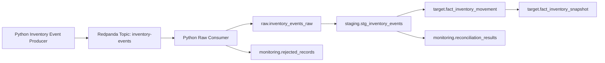

# Event Stream Integration

This project simulates event-based inventory integration using Redpanda, a Kafka-compatible event streaming platform.

## Current Flow



## Topic

| Topic | Description |
|---|---|
| `inventory-events` | Inventory movements from a simulated warehouse event stream |

## Event Types

| Event Type | Meaning |
|---|---|
| `INVENTORY_RECEIVED` | Stock received into a location |
| `INVENTORY_ADJUSTED` | Manual or cycle count adjustment |
| `INVENTORY_TRANSFERRED` | Stock transferred between locations |
| `INVENTORY_RESERVED` | Stock reserved for demand |
| `INVENTORY_RELEASED` | Reserved stock released |

## Data Quality Rules

The event validation process checks:

- Required `event_id`
- Valid `event_type`
- Existing `product_id`
- Existing `location_id`
- Non-zero `quantity_change`
- Valid `reason_code`
- Required `event_timestamp`
- Required `published_at`
- `published_at` cannot be before `event_timestamp`
- Duplicate `event_id` handling

## Rejected Records

Duplicate events are rejected at raw ingestion using `event_id` idempotency.

Invalid business events are rejected during staging validation.

Rejected records are stored in:

```text
monitoring.rejected_records
```

## Target Tables

| Table | Description |
|---|---|
| `target.fact_inventory_movement` | One row per accepted inventory event |
| `target.fact_inventory_snapshot` | Current inventory position by product and location |

## Run Producer

```powershell
python scripts/produce_inventory_events.py --count 200 --seed 42
```

## Consume Events to Raw

```powershell
python scripts/consume_inventory_events_to_raw.py --max-messages 206
```

## Validate Events

```powershell
python scripts/validate_inventory_event_batch.py
```

## Load Inventory Targets

```powershell
python scripts/load_inventory_targets.py
```

## Expected Demo Result

The default demo produces 206 events:

| Metric | Expected Behavior |
|---|---|
| Produced events | 206 |
| Raw inserted | 205 |
| Duplicate ignored | 1 |
| Accepted events | Majority accepted |
| Rejected events | Duplicate + intentional invalid events |
| Reconciliation | `MATCHED_WITH_REJECTIONS` |