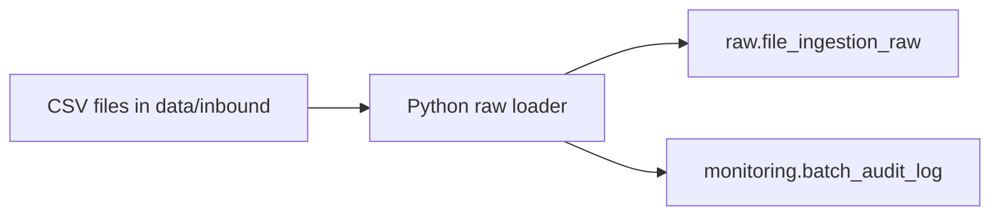

# Flat File Integration

This project simulates ERP-style flat file integrations for retail supply chain master data.

## Current Flow


This temporary Python-based raw loader is used to validate the database design and audit model before implementing the same ingestion pattern visually in Apache NiFi.

## Entities

| Entity | Source Folder | Raw Table |
|---|---|---|
| Suppliers | `data/inbound/suppliers/` | `raw.file_ingestion_raw` |
| Products | `data/inbound/products/` | `raw.file_ingestion_raw` |
| Locations | `data/inbound/locations/` | `raw.file_ingestion_raw` |

## Batch Audit Behavior

Each source file creates one row in `monitoring.batch_audit_log`.

At raw ingestion time:

| Field | Meaning |
|---|---|
| `source_count` | Number of rows found in the source file |
| `accepted_count` | Populated after validation |
| `rejected_count` | Populated after validation |
| `loaded_count` | Populated after target load |
| `status` | Starts as `STARTED`, then becomes final after validation/reconciliation |

## Run Raw Load

```powershell
python scripts/load_master_data_to_raw.py
```

## Load One Entity

```powershell
python scripts/load_master_data_to_raw.py --entity products
```

## Load Specific Batch Date

```powershell
python scripts/load_master_data_to_raw.py --batch-date 20260702
```