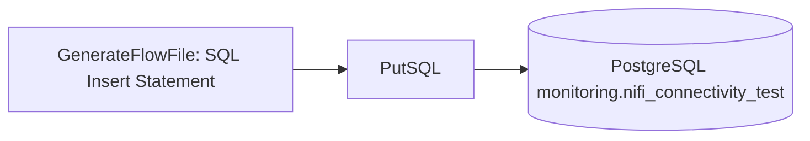

# Apache NiFi Integration

Apache NiFi is used as the middleware layer for visual data flow orchestration.

This project uses NiFi to demonstrate enterprise-style integration patterns such as:

- JDBC connectivity to PostgreSQL
- Flat-file ingestion orchestration
- API ingestion orchestration
- Event stream ingestion design
- Operational troubleshooting through visible processor relationships

## PostgreSQL JDBC Connection

NiFi connects to PostgreSQL through a `DBCPConnectionPool` controller service.

| Property | Value |
|---|---|
| Database Connection URL | `jdbc:postgresql://postgres:5432/integration_platform` |
| Database Driver Class Name | `org.postgresql.Driver` |
| Database Driver Location(s) | `/opt/nifi/nifi-current/drivers/postgresql-42.7.12.jar` |
| Database User | `integration_user` |
| Validation Query | `select 1` |

## Connectivity Test

A simple NiFi flow validates database connectivity:



## Validation Query

```powershell
docker exec -it rscp_postgres psql -U integration_user -d integration_platform -c "select test_name, test_status, details, created_at from monitoring.nifi_connectivity_test order by created_at desc limit 5;"
```

## Design Decision

NiFi is used to orchestrate movement and integration flows, while PostgreSQL handles SQL-based validation, upserts, reconciliation, and audit logging.

This separation mirrors real enterprise integration patterns where middleware handles orchestration and routing, while the database handles deterministic validation and persistence logic.

## API Ingestion Demo

NiFi also includes an API ingestion demo for sales order data.

```mermaid
flowchart LR
    A[InvokeHTTP: Mock Enterprise API] --> B[SplitJson: $.data[*]]
    B --> C[PutDatabaseRecord]
    C --> D[(raw.nifi_sales_orders_api_raw)]
```

## Demo Table

```text
raw.nifi_sales_orders_api_raw
```

## Demo Flow

| Processor | Purpose |
|---|---|
| `InvokeHTTP` | Calls the mock enterprise API from inside the Docker network |
| `SplitJson` | Splits the API response array into individual sales order records |
| `JsonTreeReader` | Parses each JSON record |
| `PutDatabaseRecord` | Inserts records into PostgreSQL using JDBC |

## API URL Used Inside NiFi

```text
http://mock-api:8000/api/v1/sales-orders?limit=25&include_bad_records=true
```

## Validation Query

```powershell
docker exec -it rscp_postgres psql -U integration_user -d integration_platform -c "select count(*) as nifi_loaded_sales_orders from raw.nifi_sales_orders_api_raw;"
```

Expected result:

```text
25
```

## Design Note

This NiFi API demo proves middleware-based API ingestion into PostgreSQL. The main production-style API pipeline still uses raw/staging/target tables, SQL validation, rejected records, audit logging, and reconciliation.