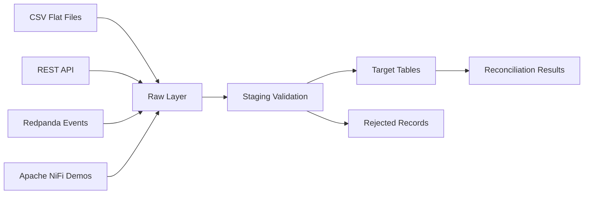

# Reviewer Guide

## What This Project Demonstrates

This project demonstrates a production-style retail supply chain data integration platform.

It is not a simple ETL script. It covers multiple real integration patterns:

- flat-file ingestion
- REST API ingestion
- event-stream ingestion
- Apache NiFi middleware demos
- raw/staging/target data layers
- rejected record handling
- audit logging
- source-to-target reconciliation
- duplicate event handling
- operational troubleshooting documentation

## 5-Minute Review Path

If you only have a few minutes, review these files first:

| File | Why It Matters |
|---|---|
| `README.md` | Main project overview, architecture, and run commands |
| `docs/architecture.md` | Explains system design and schema responsibilities |
| `docs/source_to_target_mapping.md` | Shows source-to-target mapping discipline |
| `docs/data_quality_rules.md` | Documents validation and rejected record rules |
| `docs/demo_walkthrough.md` | Shows how to run the full demo |
| `docs/technical_decisions.md` | Explains design decisions and tradeoffs |
| `sql/17_final_validation_checks.sql` | Proves final expected outputs |
| `sql/07_demo_queries.sql` | Provides reviewer-friendly demo queries |

## Architecture Summary



## Main Data Flows

### Flat-File Integration

```text
CSV files → raw.file_ingestion_raw → staging → target dimensions → reconciliation
```

Entities:

- suppliers
- products
- locations

### API Integration

```text
FastAPI endpoints → raw.api_ingestion_raw → staging → target facts → reconciliation
```

Entities:

- sales orders
- purchase orders
- shipments

### Event Integration

```text
Redpanda inventory-events topic → raw.inventory_events_raw → staging → target inventory tables → reconciliation
```

Entities:

- inventory movements
- inventory snapshots

### NiFi Middleware Demos

```text
GenerateFlowFile → PutSQL → PostgreSQL
GetFile → PutDatabaseRecord → PostgreSQL
InvokeHTTP → SplitJson → PutDatabaseRecord → PostgreSQL
```

## Final Validation

The project includes a final validation file:

```text
sql/17_final_validation_checks.sql
```

Run it with:

```powershell
docker exec -it rscp_postgres psql -U integration_user -d integration_platform -f /docker-entrypoint-initdb.d/17_final_validation_checks.sql
```

Expected result:

```text
All checks should return PASS.
```

## Expected Target Counts

| Table | Expected Count |
|---|---:|
| `target.dim_supplier` | 24 |
| `target.dim_product` | 233 |
| `target.dim_location` | 49 |
| `target.fact_sales_order` | 280 |
| `target.fact_purchase_order` | 136 |
| `target.fact_shipment` | 164 |
| `target.fact_inventory_movement` | 187 |
| `target.fact_inventory_snapshot` | 182 |

## Expected NiFi Demo Counts

| Table | Expected Count |
|---|---:|
| `raw.nifi_products_file_raw` | 255 |
| `raw.nifi_sales_orders_api_raw` | 25 |

## Key Engineering Patterns

### Raw Data Preservation

Raw source records are stored before validation. This supports auditability, debugging, replay, and source-system investigation.

### Rejected Record Handling

Invalid records are not silently dropped. They are stored in:

```text
monitoring.rejected_records
```

with rejection stage, rejection reason, batch ID, entity name, and raw payload.

### Reconciliation

Every production-style batch reconciles:

```text
source_count = accepted_count + rejected_count
accepted_count = loaded_count
```

A successful batch with controlled bad data has status:

```text
MATCHED_WITH_REJECTIONS
```

### Event Idempotency

Inventory events use `event_id` as an idempotency key. Duplicate events are ignored during raw ingestion and logged as rejected records with:

```text
EVENT_DEDUPLICATION
```

## Why This Project Is Relevant

This project is relevant for Data Integration Engineer, Integration Engineer, and Data Engineer roles because it demonstrates practical integration concerns beyond simple transformation:

- multiple source types
- middleware
- API extraction
- event ingestion
- source-to-target mapping
- validation rules
- rejected records
- reconciliation
- operational runbooks
- troubleshooting

## Suggested Demo Talking Points

1. The platform uses separate `raw`, `staging`, `target`, and `monitoring` schemas.
2. Raw records are preserved for traceability.
3. SQL validation separates accepted and rejected records.
4. Target loads are reconciled against source counts.
5. Redpanda demonstrates event-based integration and duplicate event handling.
6. NiFi demonstrates middleware-based file/API ingestion through JDBC.
7. Documentation includes operational and troubleshooting guides, not just code.